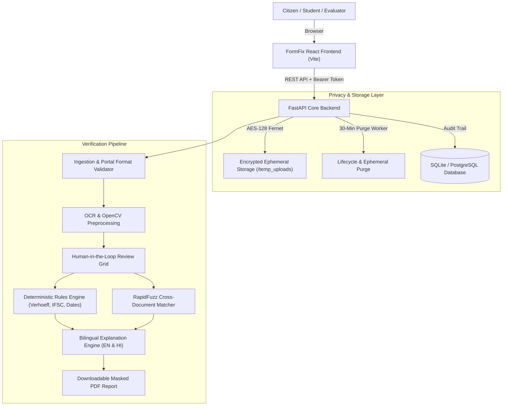

# FormFix 🛡️🇮🇳
**Smart Government Form Assistant & Deterministic Pre-Submission Validation Engine**
*(Upgraded & Rebranded from FormSaathi v1.0 to FormFix v2.0)*

> **Legal Disclaimer:** FormFix is an independent assistive validation tool built for students and citizens. It is not affiliated with, endorsed by, or connected to any government department or official scholarship portal. All results are strictly advisory and do not guarantee official government acceptance.

---

## 🚀 Executive Summary & Problem Statement
Every academic year in India, over **30% of government scholarship applications** (including Uttar Pradesh Pre-Matric and Post-Matric schemes) are outright rejected due to preventable clerical errors:
- **Subtle name discrepancies** (e.g. *Rahul Kumar Verma* on Aadhaar vs. *Rahul Verma* on High School Marksheet).
- **Expired income certificates** (UP rules mandate certificates must be issued within the last 3 years).
- **Third-party bank accounts** (e.g., linked parent or guardian accounts causing DBT/PFMS transfer failures).
- **Format and resolution constraint violations** (unreadable scans, incorrect byte formats, exceeding portal KB thresholds).

**FormFix solves this at the root.** It acts as an intelligent, privacy-compliant pre-submission shield that catches every mismatch, format violation, and rule inconsistency *before* the applicant submits their official form.

---

## 🌟 Key Upgrades & FormFix 2.0 Features

### 1. Complete Rebranding & Modern UI/UX
- Rebranded from FormSaathi to **FormFix**.
- Modern SVG brand mark communicating document verification, security, and precision.
- Responsive design tailored for mobile, tablet, and desktop screens with bilingual support (English & Hindi).
- Interactive navigation: **Home**, **Dashboard**, **Upload**, **Editable Verification Grid**, **Audit Explanations & PDF**, **User Profile & Privacy**, and **Admin Console**.

### 2. Full Authentication & Registration System (Phase 3)
- **New User Registration:** Full Name, Email, Mobile, Password, Confirm Password with OTP verification.
- **Existing User Login:** Email/Mobile + Password OR Instant OTP Login.
- **Security:** PBKDF2-HMAC-SHA256 password hashing (100,000 iterations with unique 16-byte cryptographic salt).
- **1-Click Hackathon Demo Access:** Instant login buttons for Hackathon Judges & Evaluators (`Demo Student` or `Demo Admin`).
- **Self-Service Password Reset:** Forgot Password flow via secure OTP verification.

### 3. Rigorous Document Management & DPDP Act 2023 Compliance (Phase 4)
- **Encryption at Rest:** All ephemeral uploaded files are encrypted with **AES-128 Fernet** before touching disk storage (`temp_uploads/`).
- **In-Memory Decryption:** OCR engine reads encrypted ciphertext from disk, decrypts in-memory, and feeds byte streams directly into PyMuPDF and PIL without ever writing plaintext files.
- **Automatic 30-Minute Ephemeral Purging:** Background lifecycle worker permanently erases uploaded files and temporary session keys after 30 minutes of inactivity.
- **Aadhaar & Bank Account Masking:** Irreversible redaction (`XXXX XXXX 1234`) across frontend grids, logs, and downloadable reports.
- **Right to Erasure (DPDP Act 2023 Section 12):** User-facing 1-click button to permanently purge all documents, OCR metadata, and account sessions immediately.
- **Immutable Audit Logging:** System actions (`USER_LOGIN`, `DOCUMENT_UPLOAD`, `AUDIT_RUN`, `DATA_PURGE`) recorded in encrypted `audit_logs` table.

### 4. Deterministic Core Validation Engine (Phase 5)
- **Strict Deterministic Rules:** Verhoeff 12-digit Aadhaar checksum algorithm, IFSC regex format, student age thresholds (14-35 years), certificate 3-year validity window, and income thresholds.
- **RapidFuzz Cross-Document Matching:** Token-sort fuzzy matching with Devanagari transliteration handling name variations and honorifics across Aadhaar, marksheets, and bank records.
- **Editable Verification Grid:** Human-in-the-loop review interface with color-coded confidence badges (High >85%, Medium 70-84%, Low <70%). Manual user corrections become authoritative.
- **Bilingual Grounded Explanations:** Explanations in clear Hindi and English explaining *why* an issue was flagged and the exact steps to fix it.
- **Downloadable PDF Audit Report:** High-resolution ReportLab PDF checklist summarizing readiness score, detected issues, and corrective actions.

### 5. 🎯 Hackathon Live Demo Mode (Phase 7)
Evaluators and judges can test the full pipeline in **1 click** without typing credentials or uploading personal documents:
1. **Priya Sharma (100% Clean Pass):** All 6 documents match perfectly. Flawless pass with 100/100 score.
2. **Rahul Verma (Name Discrepancy):** Aadhaar displays *Rahul Kumar Verma* vs. 10th Marksheet *Rahul Verma*. RapidFuzz flags name mismatch.
3. **Amit Patel (Expired Income Certificate):** Income certificate issued > 3 years ago + income exceeds portal ceiling. Triggers critical rejection alerts.
4. **Sunita Devi (Father's Bank Account Linked):** Passbook in father's name (*Rameshwar Devi*) instead of student's name, violating PFMS DBT rules.

---

## 🏛️ System Architecture



---

## ⚡ Quick Start & Run Instructions

### Prerequisites
- **Python 3.10+**
- **Node.js 18+**

### 1. Start Backend Server
```bash
cd backend

# Activate virtual environment
# Windows:
.venv\Scripts\activate
# Linux/macOS:
source .venv/bin/activate

# Install dependencies (if not already installed)
pip install -r requirements.txt

# Run complete automated test suite (45 unit & integration tests)
pytest tests/ -v

# Start FastAPI server on port 8000
python -m uvicorn app.main:app --reload --port 8000
```
Backend Swagger API documentation will be available at: `http://localhost:8000/docs`

### 2. Start Frontend Server
```bash
cd frontend

# Install dependencies
npm install

# Run Vite production build test
npm run build

# Start Vite development server
npm run dev
```
Frontend application will be accessible at: `http://localhost:5173`

---

## 🎤 2-Minute Hackathon Presentation Pitch Script

| Time | Slide / Screen | Spoken Pitch |
|---|---|---|
| **0:00 - 0:25** | **Home Page (`/`)** | *"Respected jury, over 30% of Indian scholarship applications are rejected every year—not because students are ineligible, but because of subtle name spelling differences, expired income certificates, or mismatched bank accounts. Meet **FormFix**—the AI-powered, DPDP Act 2023 compliant pre-submission assistant that catches these errors before students hit submit."* |
| **0:25 - 0:50** | **1-Click Demo Login (`/login`)** | *"We designed FormFix with zero friction. Judges can click **'1-Click Demo Access'** to immediately enter the platform without typing credentials or uploading personal identity documents."* |
| **0:50 - 1:20** | **Dashboard (`/dashboard`) & Scenarios** | *"On our Dashboard, evaluators can launch pre-configured synthetic datasets. Let's load the **Rahul Verma** test scenario. In 1 second, FormFix decrypts the documents, extracts OCR fields with confidence badges, and runs our deterministic rules engine alongside RapidFuzz cross-document matching."* |
| **1:20 - 1:45** | **Review Grid (`/review`) & Explanations (`/explanations`)** | *"Notice how FormFix flags the exact discrepancy: 'Aadhaar shows Rahul Kumar Verma while Marksheet shows Rahul Verma'. It doesn't hallucinate approvals. It provides grounded bilingual explanations in English and Hindi, actionable checklists, and instant PDF audit reports."* |
| **1:45 - 2:00** | **Privacy Center (`/profile`)** | *"Finally, FormFix is built privacy-first: all files are encrypted at rest with AES-128 Fernet, purged after 30 minutes, and students can permanently erase all data in one click under the DPDP Act 2023. FormFix ensures no deserving student loses their scholarship to a clerical error. Thank you!"* |

---

## 🧪 Automated Test Verification
FormFix includes a full suite of **45 automated unit and integration tests** covering:
- PBKDF2 Password Hashing, Login, and Registration OTP workflows
- 1-Click Demo Login and all synthetic test scenarios
- DPDP Act 2023 Right to Erasure (`DELETE /api/v1/me/data`)
- AES-128 Fernet encryption at rest and in-memory decryption
- Verhoeff 12-digit Aadhaar checksum algorithm & IFSC regex
- OpenCV preprocessing and bilingual OCR extractors
- RapidFuzz cross-document fuzzy name matching bands (Match, Needs Review, Mismatch)
- Deterministic rules evaluation and downloadable PDF audit reports

Run the tests anytime:
```bash
pytest backend/tests -v
```

---
© 2026 FormFix. Built for India with privacy, accuracy, and accessibility at its core.
